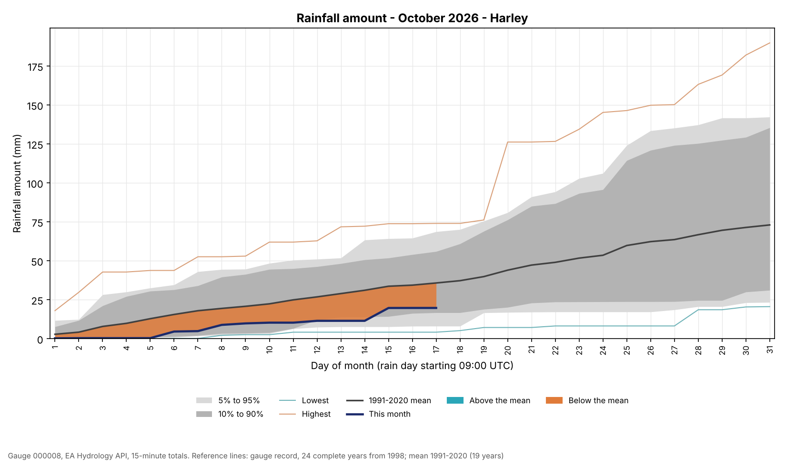

# Input_Analysis_Pipeline

Databricks jobs for the Flood Forecast Modelling team. The first pipeline downloads the EA's
15-minute rain gauge records from the Hydrology API into a Bronze store on a Unity Catalog
volume.

The jobs are written in **Python**, because the workspace's shared clusters allow only
Python and SQL, and to match the team's other notebooks. They write exactly the layout reach.io
writes, so the store reads back in R with `reach.io::read_bronze()`.

## Layout

| Path | What it holds |
|---|---|
| `jobs/rain_gauges/01_setup_store.py` to `07_rainfall_accumulation.py` | The jobs, as Databricks notebooks, in the order they run |
| `pipelines/hydrology_api.py` | The Hydrology API: measures, annual chunks of readings, retries, the one-second pause |
| `pipelines/store.py` | reach.io's Bronze layout: dataset IDs, files by year, the register and the registry |
| `pipelines/rain_gauges.py` | The registry, the chunked backfill and the incremental update |
| `pipelines/haduk.py` | Finding and reading HadUK-Grid daily rainfall at points and over areas |
| `pipelines/areas.py` | Outlines in GeoJSON, the 1 km cells inside them, Thiessen weights of gauges |
| `pipelines/accumulation.py` | 09:00 rain days, monthly running totals, reference lines, the chart |
| `pipelines/rain_charts.py` | Gauge positions, the HadUK-Grid extract, gauge and area charts, the month table |
| `pipelines/config.py` | Reading the configuration |
| `config/config.example.yml` | The settings. Copy it; never commit the copy |
| `tests/python/` | Tests, with a fake API so none touches the network |

## Setting up in Databricks

1. **Clone this repository** as a Git folder in the workspace.
2. **Nothing to install.** pandas, pyarrow, requests and pyyaml come with the Databricks
   runtime.
3. **Network.** The cluster must reach `environment.data.gov.uk`.
4. **Config.** Copy `config/config.example.yml` to the volume, for example
   `<volume>/hydrometric_config/config.yml`, and fill it in. Set the environment variable
   `PIPELINES_CONFIG` to its path, on the cluster or the job, or at the top of a notebook
   with `os.environ["PIPELINES_CONFIG"] = "..."`. A `config/config.yml` in the Git folder works
   too; git ignores it.
5. **Root.** The notebooks find the repository by looking upwards from their folder. If one
   cannot, set `PIPELINES_ROOT` to the Git folder's path.

Keep restricted data off unrestricted volumes. Open gauge data from the Hydrology API is fine
on an unrestricted one; H19, FEH SAAR and MOSES need a restricted volume of their own.

## Running the rain gauge pipeline

| Order | Job | Run | What it does |
|---|---|---|---|
| 1 | `01_setup_store` | Once | Creates the store's folders under `store_root`; safe to rerun |
| 2 | `02_build_registry` | Once, and when gauges change | Lists every 15-minute rain gauge on the API and writes the registry; a rerun adds new gauges and keeps the rest |
| 3 | `03_trial` | Once, before the backfill | Backfills a few gauges for one year, reads one back and estimates the full run's hours |
| 4 | `04_backfill` | As a job until nothing is left | Backfills every gauge not yet done, chunk by chunk |
| 5 | `05_incremental` | Monthly, as a scheduled job, a few days after the EA's monthly release | Fetches each gauge's new readings, and any the EA has revised in the look-back period |
| 6 | `06_haduk_extract` | Once, then after each HadUK-Grid release | Gauge positions, then HadUK-Grid daily rainfall for every gauge's 1 km cell and every configured area |
| 7 | `07_rainfall_accumulation` | Whenever wanted | Accumulation charts chosen from drop-downs (gauge or area, period, start year and month), and a table of where every gauge stands |
| 8 | `08_rain_qc` | After each update | Quality control, stage 1: flags each gauge's readings and days from its own record, and reports its years |

**Read the trial before the backfill.** It shows whether the volume accepts the writes and how
long a gauge-year takes. The EA asks for one request at a time, so the jobs make one request a
second.

**Each gauge's own record.** The backfill first asks the API for a gauge's first and last
readings, then fetches only the years between, clipped to the config's `start_date` and
`end_date`. A `start_date` of 1900 therefore costs nothing for a gauge that opened in 2010. In
a sample of 40 gauges in November 2026, records began between 1966 and 2020 (60% before 2000)
and averaged about 30 years: some 30,000 annual requests for 995 gauges, about 24 hours.

**Stopping and resuming.** After each chunk of `chunk_size` gauges, the backfill saves the
register, the log and the registry's done flags. A stopped job loses at most one chunk; rerun
it and it carries on. A gauge is done when it succeeded or the API holds nothing for it; a
failed gauge stays to do, so the next run tries it again.

**Monthly updates and revisions.** The EA publishes its checked 15-minute rain monthly, so
`05_incremental` runs monthly. Each run re-fetches from `lookback_days` (default 90) before a
gauge's latest stored reading, compares with what is stored, and writes only readings that are
new or that the EA has changed since: a value or quality flag revised after publication. The
log's `revised` column counts those. Unchanged readings are not written again. About 2 s a
gauge, some 35 minutes a month for 995 gauges.

**What is stored.** One Parquet file per gauge per observation year, at
`bronze/hydrometric/EA/P/<year>/EA_<gauge>_P_<received date>.parquet`, with the columns
`timestamp` (UTC), `value` (mm in the 15 minutes), `supplier_flag` (the EA's quality),
`dataset_id`, `site_id`, `data_type` and `period`. Every file written gets a row in
`register/hydrometric_data_register.csv`. Bronze is append-only: a later download of the same
gauge adds files with a later received date, and readers keep the most recently received row
per timestamp.

**Volumes and appends.** Volumes may refuse appends and in-place rewrites, so every file is
written to local disk first and copied into place whole.

**From files to tables.**

```sql
CREATE TABLE <catalog>.<schema>.bronze_rain AS
SELECT * FROM parquet.`<store_root>/bronze/hydrometric/EA/P/*/*.parquet`;
```

When building Silver, keep the most recently received row per gauge and timestamp, as the
readers do.

## Rainfall accumulation charts



In the style the Met Office publishes for the UK: the month's running total day by day against
the reference lines from earlier years, the 1991-2020 mean (or, for a record that misses it,
the mean of all its years), the 5, 10, 90 and 95% lines, and the lowest and highest. Shaded
blue where the month is above the mean, orange below.

- **Choosing a chart.** Drop-downs at the top of `07_rainfall_accumulation` choose the gauge
  (type to search by id or name), the area, the period and its start year and month. Periods: a
  month; three, six or twelve months from the start month (three from December is the winter);
  the water year, October to September, named by the year it starts; or the calendar year. To
  redraw on every change, set the widget panel's "On widget change" to "Run notebook".
- **Only readings on the 15-minute grid count.** The EA record holds a few readings at other
  minutes (21 at Harley in 2024 and 2025, some as large as 145 mm in a reading); summing them
  would double-count, so they are left out and counted in the chart's footnote. The Bronze store
  keeps them as received.
- **Rain days run 09:00 to 09:00 UTC**, named by the day they start, as in HadUK-Grid. A day
  counts only with 95% of its 96 readings (`accumulation.min_complete`), and a month counts
  towards the reference lines only if every day does, so a gap is never taken for a dry spell.
- **A gauge** is drawn against its own record when it has at least `accumulation.min_years`
  complete months (default 20), else against HadUK-Grid at its 1 km cell. Where HadUK-Grid
  covers the month, its cell is drawn dashed beside the gauge, as a check on the gauge.
- **A catchment or area** (a GeoJSON outline in British National Grid metres, listed under
  `areas`) is drawn against HadUK-Grid averaged over its cells. The month itself comes from
  HadUK-Grid where the files cover it, else from the gauges by Thiessen weights on the 1 km
  grid, a failed gauge's weight shared among the others as in the operational scheme.
- **The month table** ranks every gauge's month among its own years (0 driest, 1 wettest)
  beside the median rank of its five nearest gauges. A gauge far from its neighbours
  (`odd_one_out`) has more likely failed than seen unusual weather.

**Daily tables.** The charts and the gauge table read each gauge's daily totals from
`gold/rain_daily/<gauge>.parquet`, about 11,000 rows for 30 years, not the million or so
15-minute readings behind them. A table is rebuilt whenever the gauge's Bronze files are newer
than it, and `05_incremental` rebuilds the changed ones after each update. The first build of
all 995 takes a while; after that a chart takes about a second and the gauge table a minute or
two. The completeness threshold is applied on reading, so changing it needs no rebuild.

Each day also counts its readings by the EA's quality flag (`n_good`, `n_estimated`,
`n_unchecked`, `n_suspect`, `n_missing`, `n_other`). No reading is dropped for its flag: the
daily tables summarise the raw record, and quality control decides what to trust. At Harley,
1997 to 2026, 50% of readings are Unchecked, 42% Good, 8% Suspect and 1% Missing. Until quality
control is in place, read the charts and daily totals as a first look at raw data, not as
checked figures for model input.

HadUK-Grid is read once by `06_haduk_extract` into one Parquet file a year under
`gold/haduk/rainfall_daily/`: reading the NetCDF files for every chart would be far too slow.
The notebooks install `xarray` and `netCDF4` with `%pip` if the runtime lacks them. HadUK-Grid
is interpolated from rain gauges, many of them these, so it is a good check for gross errors
and changes but not proof that a gauge is right to within a few per cent.

## Quality control

Stage 1 checks each gauge against its own record, after Lewis et al. (2018, 2021): readings off
the quarter hour or negative (rejected); extreme 15-minute or daily amounts, the same amount
repeated for hours, totals dumped after an outage, and readings the EA flagged Suspect
(suspect). Each year reports the tip resolution, the largest share of rain in one hour of the
day, and the weekend share. Results go to `gold/qc/`: flagged readings, flagged days and years
per gauge, and `summary.csv` across the network. Nothing in the store is removed or changed;
flags are on reach.io's scale (1 good, 3 suspect, 4 rejected) and users decide what to leave
out. The thresholds are settings under `qc`, provisional until checked against the papers.

At Harley (000008) stage 1 rejects the 10 days holding its 21 off-grid readings, marks 935
days the EA flagged Suspect, and finds the tip resolution changing from 0.2 mm to 0.01 mm on
1 August 2024: a new instrument, logger or processing, which splits the record.

Stage 2 checks each gauge's daily totals against HadUK-Grid at its 1 km cell and against the
median of its five nearest gauges within 30 km: dry when they are wet, wet when they are dry,
out by more than three times, months under half or over twice, and years shifted by a day. Each
neighbour is first brought to the gauge's own long-term level, so a hill gauge is not flagged
for being wetter than the valley (Langsett takes about 1.5 times its neighbours' rain: 58
months flagged unscaled, 5 scaled). All stage-2 flags are suspect. Results in
`gold/qc/stage2/`; `rain_qc.day_flags()` combines both stages.

Six real gauges round Harley, 1997 to 2026, gave 27 months off in about 1,800: months near zero
against wet neighbours (Wombwell March 2002, Ringinglow February 2010, Woodhouse Mill August
2004, Harley July 2001 and November 2024), and mostly summer months too wet, often real storms.
All six change tip resolution between 2023 and 2026, a change across the EA network.

Stage 3, to come: tests on whole records against HadUK-Grid and SAAR (long-term ratios, trends,
breakpoints).

## Testing

```bash
python -m pytest
ruff check .
```

The tests use a fake API and a temporary folder for the volume. The five notebooks were also
dry-run in order against the fake API, including a failed gauge retried on a second run. Not
yet tested: the real API, a real volume, and reading the Python-written files back with
reach.io in R. The trial job is the first real check.
